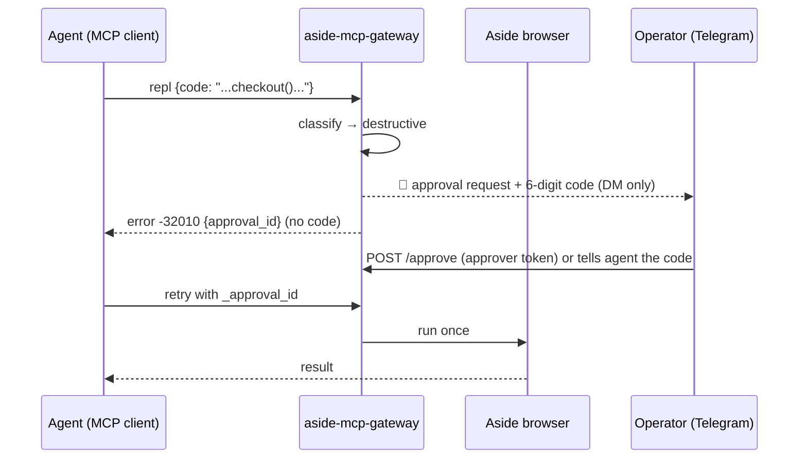

# aside-mcp-gateway

A **resident MCP gateway** on top of the official `aside mcp` (stdio).
It lets multiple AI clients on a private network (Claude Code / Desktop,
ChatGPT, personal agents and bots) **share one Aside browser**.
Security model: [docs/SECURITY.md](docs/SECURITY.md); agent usage: [SKILL.md](SKILL.md)
(skill name `aside-browser` — drop it into Claude Code, Codex or any agent that reads SKILL.md).

- Korean version: [README.md](README.md)
- Third-party setup: [QUICKSTART.md](QUICKSTART.md)
- License: MIT ([LICENSE](LICENSE))

> This project is an **original gateway** wrapping the official `aside mcp`
> feature of the Aside AI browser (AT YOUR SIDE INC). The gateway code, safety
> gate, skill, tests and docs were all written from scratch in this repo.
> `aside mcp` itself is Aside's official product and requires a separate
> account/subscription.

## What is this

`aside mcp` is a subcommand of the official Aside CLI. It starts a standard
MCP server exposing exactly **one tool, `repl`** — it runs Playwright-style
JavaScript in a persistent sandbox attached to the Aside browser, with
snapshots (AX tree), screenshots, `fs` file access, and `fetch` carrying the
user's cookies. In other words, **an agent holding a real browser in its hand**.

The catch: `aside mcp` is a stdio process, so it must be launched on the
machine where Aside is installed. This gateway turns it into an **always-on
HTTP MCP server**:

- One process = one MCP session (keyed by `Mcp-Session-Id`), reaped after 30 min idle
- Per-client Bearer token authentication
- **Named sessions** (`X-Aside-Session` header): reconnect and keep the same browser session and JS scope
- **Async jobs** (`aside_job_start/status/result`): fire a long task, collect the result later
- **Safety gate**: every `repl` call is classified read/write/destructive. Destructive
  calls **never run without the user's approval** (see Security model)
- **Preview**: latest screenshot via the `aside_preview_latest` tool and `/preview.jpg`

## When is it useful

### 1. Remote-controlling your browser — "let my AI assistant drive my browser"
Your home/office machine (e.g. a Mac mini) runs the browser; from your phone or
work PC you drive it through an AI agent. The gateway binds to a private
network (Tailscale) only, so your home browser becomes a personal "browser API".
Example: "get everything in that shop's cart ready up to just before payment",
"fill in this form and leave it as a draft".

### 2. Sites that need a login — sharing cookies and sessions
`aside mcp`'s `fetch` and pages use **your real logged-in sessions**. Agents can
operate logged-in sites without you handing over IDs and passwords. Examples:
checking an internal dashboard, screenshotting a members-only dashboard,
verifying carts and reservations.

### 3. "Fire and forget" long browser tasks — async jobs
Scraping, monitoring, repetitive form filling can take tens of minutes.
`aside_job_start` runs them in a dedicated session in the background and
notifies you on Telegram when done. The job keeps running server-side even if
your chat session drops.

### 4. Many AIs, one browser — multi-client
Claude Code (home PC), ChatGPT (via tunnel), personal bots — different
clients share one browser. Each token can have its own gate strictness, e.g.
"the bot is read-only, I can write after approval". Browser tabs are shared
app-wide, so a tab opened by one client can be continued by another.

### 5. "What if the agent pays for something by itself?" — the approval gate
This is the main reason the project exists. Handing a whole browser to an agent
is scary because of **irreversible actions**: payments, sending messages,
deleting files. The safety gate analyzes the code pattern, grades it, stops
destructive calls, and sends a **one-time approval code to the user's Telegram
DM only**. The requesting agent can never see the code by design (a structure
hardened after a self-approval hole found in an audit — see
[docs/SECURITY.md](docs/SECURITY.md)). The user just passes the code on or runs `scripts/approve.py 123456`.

### 6. Watching what the agent sees — preview
When you want to see with your own eyes what the agent is looking at. Grab the
latest screenshot any time via `aside_preview_latest` or `GET /preview.jpg`.

### Don't use it when
- Plain web search/summarization is enough (you don't need a whole browser).
- The environment has no Aside account (the official CLI + login are required).
- You'd expose it directly to the internet — keep it behind Tailscale/VPN.

## Architecture

```
Claude Code / Desktop / ChatGPT(tunnel) / bot
        │  MCP over HTTP (Bearer token)
        ▼
┌─ aside-mcp-gateway (stdlib Python, resident) ─────────────────┐
│  session mgmt (Mcp-Session-Id → child process)                │
│  named sessions (X-Aside-Session) · async jobs                │
│  safety gate (read/write/destructive classification+approval) │
│  preview cache (/preview.jpg, aside_preview_latest)          │
└───────────────┬──────────────────────────────────────────────┘
                │ stdio (one process = one session)
                ▼
        aside mcp  →  Aside browser (user's login sessions)
```

- `aside mcp` exposes only `repl`, but the gateway synthesizes
  `aside_job_*`, `aside_preview_latest`, and `browser_list_tabs` on top.
- The audit log (`logs/audit.jsonl`) records titles, lengths and grades —
  never code bodies.

## Security model (summary)

- **Transport**: bind to a private-network IP by default (e.g. Tailscale). Never
  expose directly to the internet.
- **Auth**: per-client Bearer tokens (`tokens.json`, mode 600). Rotate a single
  entry if a token leaks.
- **Approval**: destructive code needs a one-time 6-digit code. The code is sent
  to the user's Telegram DM **only** and never lands in any channel the
  requesting agent can read (issues, files, responses, logs). If Telegram
  delivery fails, the approval expires immediately (fail-closed). `/approve`
  accepts only `role: approver` tokens that are a **different party** from the
  requester; approver tokens are blocked from `/mcp` (403).
- **Least privilege**: per-token gate modes
  (`approve-destructive` | `approve-write` | `off`).
- **Denylist**: hard-blocked URL patterns (`gate.denylist_url_patterns`).
- **Secret paths**: read attempts whose code mentions `tokens.json`,
  `.env`, `.ssh`, `.aws`, `Keychains`, etc. also require approval (string-splitting can
  evade this — the fundamental fix is running Aside as a separate OS user).

See [docs/SECURITY.md](docs/SECURITY.md) for the threat model, the two approval principles and known limits.

## Quick start (summary)

Full third-party setup: [QUICKSTART.md](QUICKSTART.md).
Minimal steps on a machine with Aside installed:

```sh
git clone https://github.com/kims6305-bjk/aside-mcp-gateway
cd aside-mcp-gateway
cp config.example.json config.json   # edit aside_bin, host, telegram, ...
# write tokens.json: {"tokens": {"<random-token>": "my-client"}}
python3 gateway.py                   # or register with launchd/systemd
```

Register in Claude Code:

```sh
claude mcp add --scope user --transport http aside \
  http://<host>:11441/mcp \
  --header "Authorization: Bearer <token>"
```

## Approval flow (user's perspective)



1. Agent attempts a destructive action → gateway blocks it and returns an error
2. Your phone gets "🔐 aside gateway approval request" + 6-digit code on Telegram
3. Tell the agent the code, or run `python3 scripts/approve.py <code>` (approver token)
4. Agent retries the same call with `_approval_id` (+`_approval`) → runs once

Ignoring it means it never runs. Codes expire after 10 minutes (configurable).

## Files

| File | Description |
|---|---|
| `gateway.py` | Gateway (stdlib only) |
| `SKILL.md` | Agent skill (`aside-browser`) |
| `scripts/gateway_client.py` | One-shot CLI for non-MCP-native clients |
| `scripts/approve.py` | Operator approval CLI (approver token + the code from Telegram) |
| `config.example.json` | Config example (real `config.json`/`tokens.json` stay on the deploy machine, excluded from git) |
| `launchd/com.example.aside-mcp-gateway.plist` | launchd template (macOS, fix 3 paths) |
| `tests/` | `mock_mcp.py` mock server + `test_http.py` + `test_phase23.py` + `test_gate_selfapprove.py` |
| `docs/SECURITY.md` | Threat model, approval principles, limits |
| `QUICKSTART.md` | Third-party installation guide |

## Operations

- Stop/restart (macOS): `launchctl bootout|bootstrap gui/$(id -u) ~/Library/LaunchAgents/com.example.aside-mcp-gateway.plist`
- Logs: `logs/` (`audit.jsonl` — titles, lengths and grades only, no code bodies)
- Add a token: append `"<token>": "<client-name>"` or
  `"<token>": {"name": "...", "gate": "...", "role": "approver"}` to
  `tokens.json` → `tokens` (no restart needed, read per request)
- Health: `GET /healthz`

## Changelog (excerpts)

- 2026-10-20 Phase 0: measured `aside mcp` (single `repl` tool, session/tab sharing model)
- 2026-10-20 Phase 1: resident minimal gateway + 12/12 E2E
- 2026-10-20 Phase 2: named sessions, async jobs, completion notifications
- 2026-10-20 Phase 3: safety gate, approval codes, preview
- 2026-10-20 **self-approval hole fix**: codes go to the user's Telegram DM only,
  fail-closed, approver role separation, secret-path classification
- 2026-10-20 public packaging: MIT license, English README, QUICKSTART, config-based Telegram setup
