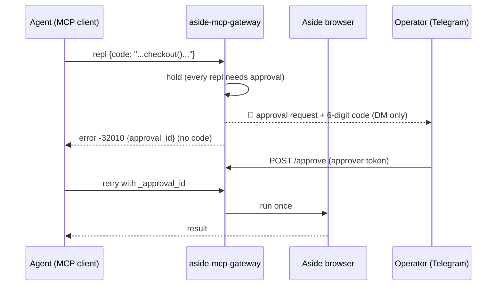

# aside-mcp-gateway

공식 `aside mcp`(stdio) 위에 얹는 **상주형 MCP 게이트웨이**.
Aside AI 브라우저를 Tailscale/VPN 안의 여러 AI 클라이언트(Claude Code·데스크톱, ChatGPT, 개인 에이전트·봇)가 **하나의 브라우저를 공유**해 쓸 수 있게 해준다.
보안 모델은 [docs/SECURITY.md](docs/SECURITY.md), 에이전트용 사용법은 [SKILL.md](SKILL.md) (스킬 이름: `aside-browser` — Claude Code·Codex 등 SKILL.md를 읽는 에이전트에 그대로 넣으면 된다).

- English version: [README.en.md](README.en.md)
- Third-party setup: [QUICKSTART.md](QUICKSTART.md)
- License: MIT ([LICENSE](LICENSE))

> 이 프로젝트는 Aside 회사(AT YOUR SIDE INC)의 공식 CLI 기능인 `aside mcp`를 감싸는
> **오리지널 게이트웨이**다. 게이트웨이 코드·안전 게이트·스킬·테스트·문서는 전부 이 레포에서
> 처음 작성된 것이다. `aside mcp` 자체는 Aside의 공식 제품이며 별도의 계정/구독이 필요하다.

## 이게 뭔가요

`aside mcp`는 공식 Aside CLI의 서브커맨드다. 실행하면 표준 MCP 서버가 하나 뜨고,
도구는 **`repl` 단 하나** — Playwright 스타일 JavaScript를 Aside 브라우저에 붙은
영속 샌드박스에서 실행한다. 스냅샷(AX 트리), 스크린샷, `fs` 파일 접근, 사용자 쿠키가
실린 `fetch`까지 된다. 즉, **에이전트가 진짜 브라우저를 손에 쥐는 것**과 같다.

문제는 `aside mcp`가 stdio 프로세스라서, 쓰려면 Aside가 깔린 그 머신에서 직접
띄워야 한다는 점이다. 이 게이트웨이는 그걸 **항상 켜져 있는 HTTP MCP 서버**로
바꿔준다:

- 프로세스 1개 = MCP 세션 1개 (`Mcp-Session-Id`로 구분), 유휴 30분 정리
- 클라이언트별 Bearer 토큰 인증
- **명명 세션** (`X-Aside-Session` 헤더): 재연결해도 같은 브라우저 세션·JS 스코프가 이어짐
- **비동기 잡** (`aside_job_start/status/result`): 긴 작업을 맡겨놓고 나중에 결과만 받기
- **안전 게이트**: 모든 `repl` 코드는 **사용자 승인 없이는 실행 안 됨**. 패턴 분석은
  승인 요청에 사유를 붙이는 데만 쓴다 (아래 보안 모델 참조)
- **미리보기**: 최신 스크린샷을 `aside_preview_latest` 도구·`/preview.jpg`로 제공

## 언제 유용하고, 어떨 때 쓰나요

### 1. "내 브라우저를 AI 비서에게 맡기고 싶을 때" — 원격 브라우저 조종
집/사무실에 항상 켜져 있는 머신(예: 맥미니)의 브라우저를, 외출 중 폰이나
회사 PC에서 AI 에이전트를 통해 조종하고 싶을 때. 게이트웨이는 Tailscale 같은
사설망에만 바인딩되므로, 집 브라우저가 집 안에서만 열린 "개인용 브라우저 API"가 된다.
예: "저 쇼핑몰 장바구니에 담긴 거 결제 직전까지만 준비해줘", "이 폼 채워서 초안까지만 만들어줘".

### 2. 로그인된 사이트를 에이전트가 써야 할 때 — 쿠키·세션 공유
`aside mcp`의 `fetch`와 페이지는 **사용자의 실제 로그인 세션**을 그대로 쓴다.
에이전트에게 일일이 ID/비밀번호를 넘기지 않고도, 로그인된 상태의 사이트를
조작할 수 있다. 예: 사내 인트라넷 조회, 로그인 필요한 대시보드 스크린샷 수집,
장바구니·예약 확인.

### 3. 오래 걸리는 브라우저 작업을 "맡겨놓고" 싶을 때 — 비동기 잡
크롤링·모니터링·반복 입력 같은 작업은 수십 분 걸린다. `aside_job_start`로
던져놓으면 전용 세션에서 백그라운드로 돌고, 끝나면 텔레그램으로 알려준다.
채팅 세션이 끊겨도 작업은 서버에서 계속 돈다.

### 4. 여러 AI를 하나의 브라우저에 붙이고 싶을 때 — 멀티 클라이언트
Claude Code(집 PC), ChatGPT(터널 경유), 개인 봇 등 서로 다른
클라이언트가 같은 브라우저를 공유한다. 토큰마다 게이트 강도를 다르게 줄 수
있어서, 예를 들어 "봇은 읽기만, 나는 승인 후 쓰기" 같은 분리가 된다.
브라우저 탭은 앱 전역 공유라서, 한 클라이언트가 연 탭을 다른 클라이언트가
이어서 볼 수도 있다.

### 5. "에이전트가 멋대로 결제·발송하지 않을까" 걱정될 때 — 승인 게이트
이게 이 프로젝트가 존재하는 가장 큰 이유다. 에이전트에게 브라우저를 통째로
맡기면 결제·메시지 발송·파일 삭제 같은 **되돌릴 수 없는 행동**이 두렵다.
안전 게이트는 모든 `repl` 호출을 멈추고(코드 패턴은 사유 표시용),  **사용자의 텔레그램 DM으로만 1회용 승인 코드**를 보낸다.
요청 에이전트는 코드를 절대 볼 수 없게 설계되어 있다(감사에서 발견된 자기승인
구멍을 막은 구조 — [docs/SECURITY.md](docs/SECURITY.md)). 사용자는 approver 토큰으로
`scripts/approve.py 123456`을 실행하면 된다. 코드를 에이전트에게 알려주지 않는다.

### 6. 브라우저 화면을 실시간으로 보고 싶을 때 — 미리보기
에이전트가 뭘 보고 있는지 사람이 직접 확인하고 싶을 때. `aside_preview_latest`
도구나 `/preview.jpg` 엔드포인트로 최신 스크린샷을 바로 볼 수 있다.
(엑셀 작업창 미리보기 같은 응용의 재료가 된다.)

### 이런 경우엔 쓰지 마세요
- 단순 웹 검색·요약이면 이거보다 가벼운 방법이 많다 (브라우저 통째가 필요 없음).
- Aside 계정이 없는 환경에서는 동작하지 않는다 (공식 CLI + 로그인 필수).
- 인터넷에 직접 노출해서는 안 된다 — 반드시 Tailscale/VPN 같은 사설망 뒤에 둘 것.

## 아키텍처

```
Claude Code / Desktop / ChatGPT(tunnel) / bot
        │  MCP over HTTP (Bearer 토큰)
        ▼
┌─ aside-mcp-gateway (stdlib Python, 상주) ──────────────┐
│  세션 관리 (Mcp-Session-Id → 자식 프로세스)              │
│  명명 세션 (X-Aside-Session) · 비동기 잡                │
│  안전 게이트 (모든 repl 승인 + 사유 패턴 표시)           │
│  미리보기 캐시 (/preview.jpg, aside_preview_latest)     │
└───────────────┬────────────────────────────────────────┘
                │ stdio (프로세스 1개 = 세션 1개)
                ▼
        aside mcp  →  Aside 브라우저 (사용자 로그인 세션)
```

- `aside mcp`의 도구는 `repl` 하나지만, 게이트웨이가 그 위에
  `aside_job_*`, `aside_preview_latest`, `browser_list_tabs`를 합성한다.
- 감사 로그(`logs/audit.jsonl`)에는 코드 본문이 아니라 title·길이·등급만 남는다.

## 보안 모델 (요약)

- **전송**: 기본 바인딩은 사설망 IP (예: Tailscale). 인터넷 직접 노출 금지.
- **인증**: 클라이언트별 Bearer 토큰 (`tokens.json`, 600 권한). 토큰 유출 시 해당
  항목만 교체하면 된다.
- **승인**: 모든 `repl` 코드는 1회용 6자리 코드 승인 필요(임의 JS는 문자열 검사로
  읽기 전용임을 증명할 수 없기 때문 — 별칭·계산된 속성·이스케이프로 우회 실측). 코드는 사용자
  텔레그램 DM으로만 전송되며, 요청 에이전트가 읽을 수 있는 어떤 채널(이슈·파일·
  응답·로그)에도 남지 않는다. 텔레그램 전송 실패 시 해당 승인은 즉시 만료
  (fail-closed). `/approve`는 `role: approver` 토큰이면서 요청자와 다른 주체만
  호출할 수 있고, approver 토큰은 `/mcp` 호출이 차단된다. 승인은 요청 토큰·세션·코드
  해시에 묶여 1회만 쓰이고, 코드 오답이 반복되면 해당 승인이 잠긴다.
- **세션 소유권**: 명명 세션·잡·미리보기는 만든 토큰만 쓰고 지울 수 있다.
- **denylist**: URL 패턴 하드 차단 (`gate.denylist_url_patterns`).
- **비밀 경로**: 코드에 `tokens.json`, `.env`, `.ssh`, `.aws`, `Keychains` 같은
  문자열이 들어간 읽기 시도도 승인 대상으로 분류된다 (문자열 쪼개기 우회는
  가능 — 근본 대책은 Aside를 별도 OS 사용자로 실행하는 것).

위협 모델·승인 원칙 2개·알려진 한계는 [docs/SECURITY.md](docs/SECURITY.md)를 볼 것.

## 빠른 시작 (요약)

타인이 처음부터 설치하는 전체 순서는 [QUICKSTART.md](QUICKSTART.md)를 볼 것.
이미 Aside가 깔린 머신에서의 최소 절차:

```sh
git clone https://github.com/kims6305-bjk/aside-mcp-gateway
cd aside-mcp-gateway
cp config.example.json config.json   # aside_bin, host, telegram 등 수정
# tokens.json 작성: {"tokens": {"<랜덤토큰>": "my-client"}}
python3 gateway.py                    # 또는 launchd/systemd 등록
```

Claude Code 등록:

```sh
claude mcp add --scope user --transport http aside \
  http://<host>:11441/mcp \
  --header "Authorization: Bearer <토큰>"
```

## 승인 흐름 (사용자 관점)



1. 에이전트가 `repl` 코드를 실행하려 함 → 게이트웨이가 멈추고 `approval_id` 반환
2. 사용자 폰의 텔레그램으로 "🔐 aside 게이트웨이 승인요청" + 6자리 코드 도착
3. 사용자가 `python3 scripts/approve.py <코드>`(approver 토큰) 실행
4. 에이전트가 같은 세션에서 같은 호출을 `_approval_id`와 함께 재시도 → 1회 실행

무시하면 실행되지 않는다. 코드는 10분(설정 가능) 후 만료.

## 파일

| 파일 | 설명 |
|---|---|
| `gateway.py` | 게이트웨이 본체 (stdlib 전용) |
| `SKILL.md` | 에이전트용 스킬 (`aside-browser`) |
| `scripts/gateway_client.py` | MCP 비네이티브 클라이언트용 1회성 CLI |
| `scripts/approve.py` | 운영자용 승인 CLI (approver 토큰, 텔레그램으로 받은 코드 입력) |
| `config.example.json` | 설정 예시 (실제 `config.json`·`tokens.json`은 배포 머신에만, git 제외) |
| `launchd/com.example.aside-mcp-gateway.plist` | launchd 등록 템플릿 (macOS, 경로 3곳 수정) |
| `tests/` | `mock_mcp.py` 목 서버 + `test_http.py` + `test_phase23.py` + `test_gate_selfapprove.py` + `test_gate_redteam.py` |
| `docs/SECURITY.md` | 위협 모델·승인 원칙·한계 |
| `QUICKSTART.md` | 타인용 설치 가이드 |

## 운영 메모

- 중지/재시작 (macOS): `launchctl bootout|bootstrap gui/$(id -u) ~/Library/LaunchAgents/com.example.aside-mcp-gateway.plist`
- 로그: `logs/` (`audit.jsonl` — 코드 본문은 기록하지 않고 title·길이·등급만)
- 토큰 추가: `tokens.json`의 `tokens`에 `"<토큰>": "<클라이언트명>"` 또는
  `"<토큰>": {"name": "...", "gate": "...", "role": "approver"}` 추가 (재시작 불필요, 요청마다 읽음)
- 상태 확인: `GET /healthz`

## 변경 이력 (발췌)

- 2026-10-20 Phase 0: `aside mcp` 실측 (도구 `repl` 1개, 세션/탭 공유 구조 확정)
- 2026-10-20 Phase 1: 최소 게이트웨이 상주 + E2E 12/12
- 2026-10-20 Phase 2: 명명 세션·비동기 잡·완료 통지
- 2026-10-20 Phase 3: 안전 게이트·승인 코드·미리보기
- 2026-10-20 **자기승인 구멍 수정**: 승인 코드는 사용자 텔레그램 DM으로만 전송,
  fail-closed, approver 역할 분리, 비밀 경로 패턴 분류
- 2026-10-20 공개 패키지화: MIT 라이선스, 영문 README, QUICKSTART, Telegram 설정 config화
